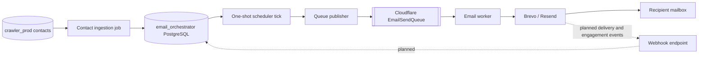
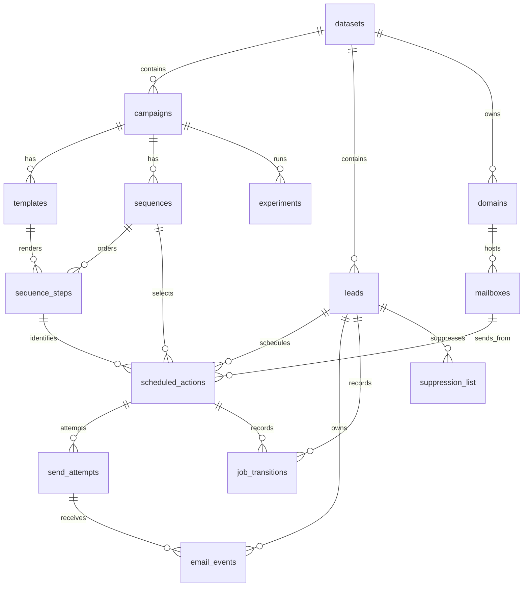
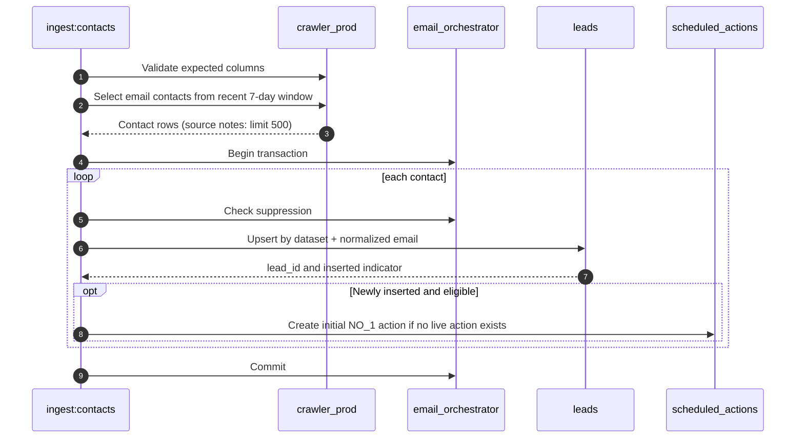
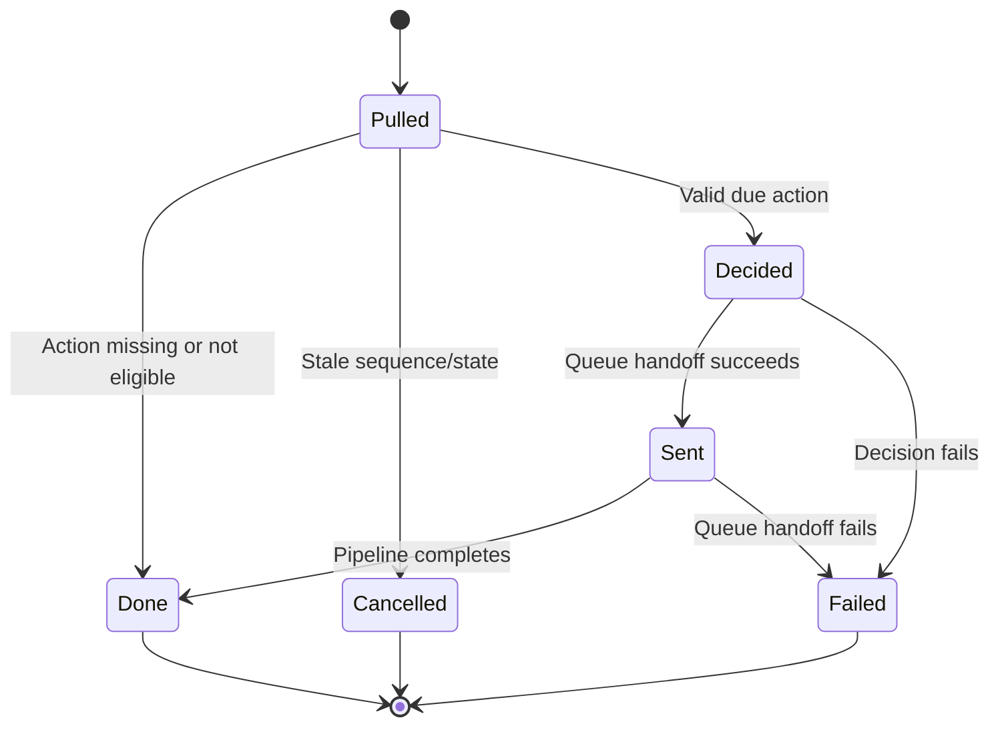
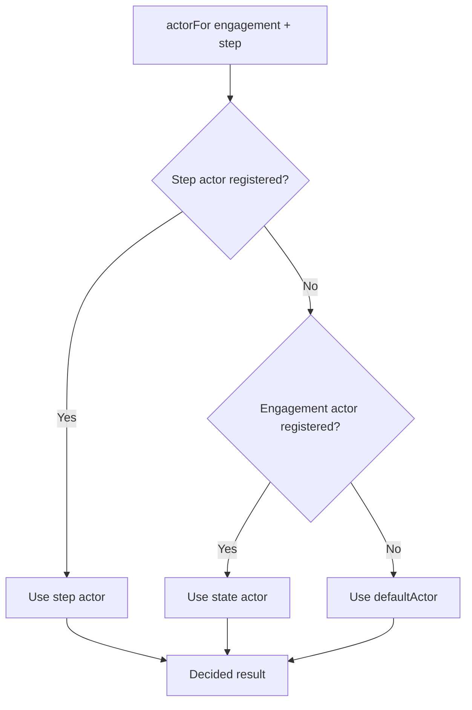
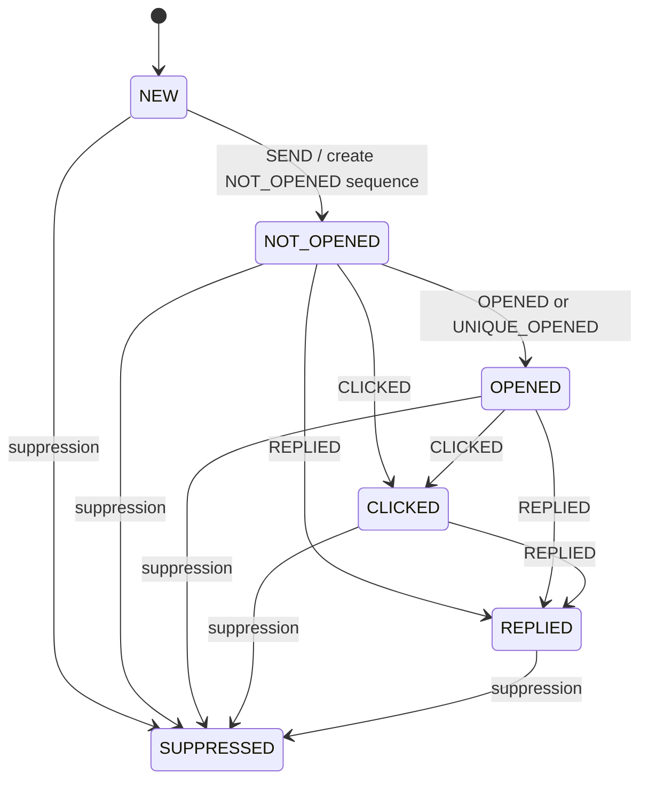
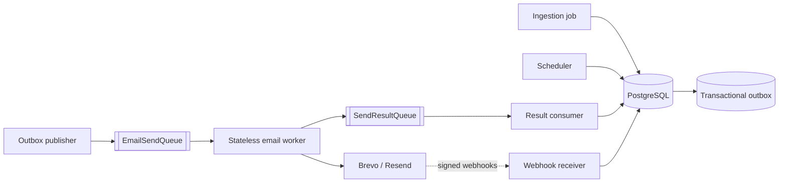
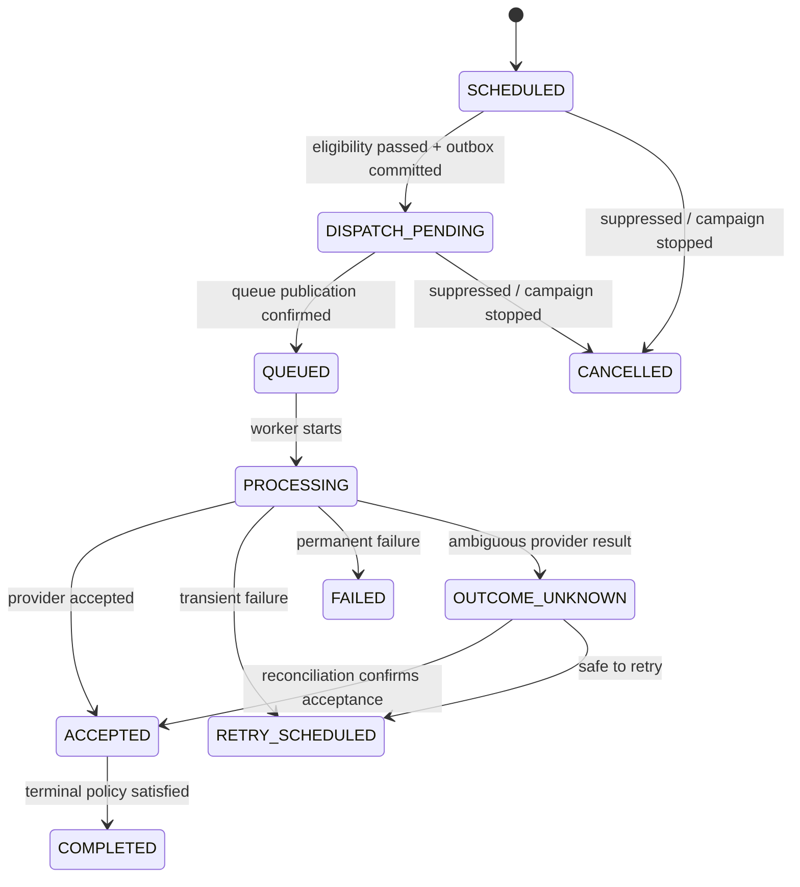
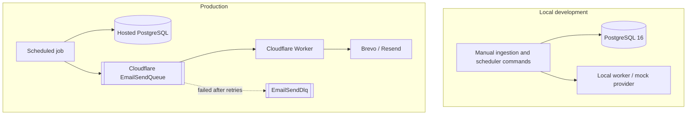

# Email Orchestrator — Architecture and Engineering Design

> **Document type:** Engineering architecture reference
> **Scope:** Current implementation, correctness constraints, operational risks, and recommended evolution
> **Status:** Reflects the supplied architecture notes; recommendations are explicitly labelled
> **Last reviewed:** 15 October 2026

## 1. Executive summary

The Email Orchestrator turns eligible contact records into scheduled email actions, creates a send payload, publishes it to a queue, and lets a separate worker call an email provider. PostgreSQL is the source of truth for business state. The worker is intentionally narrow: it consumes a payload, calls a provider adapter, classifies the result, and acknowledges or retries the queue message.

The current design has a useful separation of responsibilities and several good foundations: a relational state model, idempotent contact upserts, a partial unique index preventing multiple live actions for the same lead/sequence/step, `FOR UPDATE SKIP LOCKED` for competing schedulers, provider adapters, and a dead-letter queue.

However, the supplied notes also identify gaps that affect production correctness: worker outcomes are not persisted to the database, webhooks are not implemented, suppression is not enforced at the final send boundary, daily sender limits are not enforced, and the local queue is not durable. There is also a database/queue atomicity gap whenever a database transaction both changes business state and publishes to an external queue.

**Recommendation:** Treat the current implementation as a strong foundation, not yet as a fully production-ready email delivery system. Before increasing volume, close the safety and correctness gaps around suppression, rate limits, durable dispatch, attempt outcomes, and duplicate-send handling.

### Status labels used in this document

- **Current:** Explicitly described as implemented in the supplied architecture notes.
- **Known gap:** Explicitly described as unimplemented or incomplete in those notes.
- **Recommendation:** Proposed engineering improvement; it should not be read as existing behavior.
- **Verify:** A behavior or contract that should be confirmed against code and migrations before relying on it.

## 2. Goals, boundaries, and non-goals

### Goals

- Ingest contact records from the crawler database into the orchestrator database.
- Schedule email actions according to campaign sequence, step, and engagement state.
- Publish self-contained send jobs to a durable queue in production.
- Send through provider adapters without giving the worker ownership of campaign decisions.
- Persist enough state and event history to recover from retries, provider failures, and process restarts.
- Enforce recipient eligibility, suppression, and sender limits before an email is sent.

### Architectural boundaries

| Component | Owns | Must not own |
|---|---|---|
| Ingestion job | Reading source contacts, normalizing fields, upserting leads, initial scheduling | Provider calls or campaign execution |
| Orchestrator | Campaign and sequence decisions, action state, eligibility, scheduling, durable dispatch intent | Direct provider API calls |
| PostgreSQL | Durable business state, constraints, attempts, event records, dispatch intent | External provider side effects |
| Queue | Durable delivery of work, redelivery, retry and dead-letter mechanics | Business eligibility or sequence decisions |
| Worker | Payload validation, provider adapter call, provider-result classification | Choosing recipients, campaign branches, or next sequence steps |
| Provider | Accepting or rejecting send requests and emitting provider events | The orchestrator's source of truth |

The current implementation uses a `SendPayload` queue message as the primary orchestrator-to-worker boundary. The worker does not import orchestrator domain logic and does not connect directly to the orchestrator database.

### Non-goals

The system should not attempt to guarantee exactly-once email delivery merely because the database or queue is idempotent. A provider call is an external side effect: a timeout can leave the caller uncertain whether the provider accepted the message. The design must make that uncertainty observable and recoverable rather than hide it.

## 3. System architecture

### 3.1 Current end-to-end flow



**Current behavior:** Ingestion reads email contacts created within a rolling seven-day window, upserts leads, and creates the initial `NO_1` action for newly inserted, eligible leads. The one-shot scheduler processes due actions and publishes send payloads. The Cloudflare Worker consumes queue batches and calls the selected provider.

**Known gaps:** The provider webhook path is not built, worker outcomes are not written back to the orchestrator database, and business-state reconciliation is therefore incomplete.

### 3.2 Architectural rule

The orchestrator owns business state. The worker performs a bounded delivery operation. The queue is the contract boundary between them.

This separation is useful because each process can scale and deploy independently. It is not enough on its own to guarantee correctness: the message contract, idempotency strategy, retry semantics, and result-persistence path must also be explicit.

### 3.3 Current repository layout

```text
.
├── apps/
│   ├── orchestrator/
│   │   ├── src/index.ts          # Always-on HTTP server; /health only
│   │   ├── src/domain/           # Scheduler, pipeline, actors, state machines
│   │   └── src/queue/            # LocalQueue and Cloudflare queue publisher
│   └── worker/
│       ├── src/index.ts          # fetch handler and queue consumer
│       ├── src/execute.ts        # sendJob and outcome classification
│       ├── src/email/            # Brevo, Resend, and mock adapters
│       └── alchemy.run.ts        # Worker, queue, consumer and DLQ resources
├── packages/
│   ├── shared/                   # Framework-free enums and contract types
│   └── db/                       # Migrations, queries, ingestion, seeds, templates
├── scripts/                      # Documentation, diagram and task generators
├── docs/                         # Specs, plans, task tracking, architecture docs
├── tests/                        # Tests described as scaffold-level in the source notes
├── docker-compose.yml            # Local PostgreSQL 16
└── package.json                  # Bun workspace commands
```

The two applications share contract types from `@email/shared`. The worker should remain independent of the orchestrator's domain package and database package.

### 3.4 Module responsibilities

#### Orchestrator

| Module | Responsibility |
|---|---|
| `index.ts` | Always-on health endpoint; does not start the scheduler |
| `domain/run.ts` | One-shot scheduler entry point |
| `domain/tick.ts` | Loads due action IDs and invokes the pipeline for each action |
| `domain/pipeline.ts` | Coordinates pull, decision, queue handoff, and pipeline outcomes |
| `domain/orchestrator-machine.ts` | Orchestration stages: pulled, decided, sent, failure and cancellation paths |
| `domain/actors.ts` | Resolves step/state actors and persists next-step actions |
| `domain/transition.ts` | Pure engagement-state transition logic |
| `domain/precedence.ts` | Orders simultaneous domain events by priority |
| `domain/payload.ts` | Merges template fields and builds `SendPayload` |
| `queue/publisher.ts` | Selects Cloudflare Queue or the in-memory local publisher |

#### Worker

| Module | Responsibility |
|---|---|
| `index.ts` | HTTP handler and queue-batch consumer |
| `execute.ts` | Calls the sender and classifies outcomes as sent, retry, or failed |
| `email/index.ts` | Selects provider based on `EMAIL_PROVIDER` |
| `email/brevo.ts` | Brevo `POST /v3/smtp/email` adapter |
| `email/resend.ts` | Resend adapter |
| `email/mock.ts` | In-memory sender for local development |
| `email/errors.ts` | Transient/permanent error classification |

## 4. Data model and durable invariants

The supplied notes describe **14 named tables**, although their introduction says 13. Confirm the authoritative count against the migration files and keep this document aligned with the actual schema.

### 4.1 Entity relationships



### 4.2 Table catalog

| Table | Purpose | Important data / constraints to verify |
|---|---|---|
| `datasets` | Contact and sender grouping boundary | `id`, `name`, `external_key`, `created_at` |
| `campaigns` | Campaign configuration and lifecycle | `dataset_id`, `status`, `config` |
| `templates` | Subject and body content | `campaign_id`, `subject`, `html`, `text` |
| `sequences` | Engagement-specific sequence definition | `campaign_id`, `sequence_type`; DB check currently excludes `REPLIED` |
| `sequence_steps` | Ordered steps and delays | `step_code`, `step_order`, `delay_days`, `template_id`, `conditions` |
| `domains` | Sending-domain configuration and limits | `daily_limit`, `sent_today`, `status`, `health` |
| `mailboxes` | Sender identity and mailbox limits | `email`, `daily_limit`, `sent_today`, `status` |
| `leads` | Normalized recipient records | `dataset_id`, `email`, `attributes`, `engagement_state`, `suppressed_at` |
| `suppression_list` | Addresses that must not be contacted | `email`, `scope`, `reason`, optional lead/dataset reference |
| `scheduled_actions` | One scheduled sequence-step operation | Lead, sequence, step, template, sender, `action_status`, `execute_at` |
| `send_attempts` | Provider-send attempt history | `action_id`, `attempt_no`, provider, provider message ID, status and timestamps |
| `email_events` | Provider delivery/engagement events | Provider event ID, attempt/lead references, event type, timestamp, raw payload |
| `job_transitions` | State-transition audit history | Lead/action, prior state, next state, event |
| `experiments` | Campaign template experiments | A/B template references and split configuration |

The catalog reflects the supplied notes. The migration files remain authoritative for actual columns, foreign keys, delete behavior, checks, and indexes.

### 4.3 Critical database invariants

**Lead deduplication.** The source notes describe a unique index on `(dataset_id, lower(email))`. Ingestion uses an upsert against this index so a repeated sync does not create another lead for the same normalized email within a dataset.

**One active action per step.** The source notes describe a partial unique index named `scheduled_actions_active_once_idx` on `(lead_id, sequence_id, step_id)` when `action_status` is one of `SCHEDULED`, `QUEUED`, `PROCESSING`, or `RETRY_SCHEDULED`. This is the durable backstop against duplicate live actions. Verify that every code path uses the same status vocabulary.

**Suppression.** Suppression is a correctness and compliance invariant, not just an ingestion optimization. The supplied implementation checks suppression before creating an initial sequence, but the notes also say suppression is not checked in the send path. That is insufficient for a production send system because an address can become suppressed after scheduling.

**Event idempotency.** Provider webhooks can be delivered more than once. When webhooks are implemented, persist a provider event identifier with a unique constraint and process duplicate deliveries as no-ops.

**Counter consistency.** `domains.sent_today` and `mailboxes.sent_today` exist, but the source notes say the limits are not enforced. A counter without an atomic reservation/update protocol is not a concurrency-safe limit.

### 4.4 Status vocabularies described in the source

| Field | Values described in the source |
|---|---|
| `scheduled_actions.action_status` | `SCHEDULED`, `QUEUED`, `PROCESSING`, `SENT`, `RETRY_SCHEDULED`, `CANCELLED`, `FAILED`, `COMPLETED` |
| `send_attempts.status` | `REQUESTED`, `ACCEPTED`, `TRANSIENT_FAILURE`, `PERMANENT_FAILURE` |
| `leads.engagement_state` | `NEW`, `NOT_OPENED`, `OPENED`, `CLICKED`, `REPLIED`, `SUPPRESSED` |
| `sequences.sequence_type` | DB check described as `NOT_OPENED`, `OPENED`, `CLICKED`; `REPLIED` appears in shared types but not in the DB constraint |

**Recommendation:** Document legal transitions as well as legal values. Prefer database checks for impossible values and transition functions/tests for allowed moves. Do not use the word `SENT` to mean “delivered”: a successful provider API response generally establishes provider acceptance, while delivery is a later event.

## 5. Contact ingestion

### 5.1 Current flow

The ingestion command reads from the separate `crawler_prod` PostgreSQL database using `EMAIL_DATABASE_URL` and writes to the orchestrator database using `DATABASE_URL`. The two databases do not share a transaction.



### 5.2 Current extraction rules

- Require `upper(type) = 'EMAIL'`.
- Restrict `created_at` to a rolling seven-day window.
- Use `normalized_value` when present; otherwise use `value`.
- Apply a basic `@` sanity check to filter obviously malformed values.
- Record source provenance in `leads.attributes`: `source`, `source_contact_id`, `seller_id`, `dedup_key`, and `source_type`.
- Check existing suppression before creating an initial action.

A syntax check is not proof that an address is valid, deliverable, permissioned, or appropriate to contact. Keep those concepts separate in the data model and policy.

### 5.3 Ingestion risks and improvements

1. **Rolling-window gaps.** If the job does not run for more than seven days, older unprocessed records can be missed. This follows from the described seven-day filter. Consider a persisted source checkpoint/high-water mark with a small overlap window, plus idempotent upserts.
2. **Unbounded transaction growth.** The source notes show a 500-row limit and one transaction. Keep batches bounded, measure transaction duration, and define behavior for partial batch failure.
3. **Silent data-quality loss.** Count and report rejected contacts by reason instead of only dropping malformed values.
4. **Normalization contract.** Define one canonical email-normalization function and use it consistently for ingestion, unique indexes, suppression checks, and provider event matching.
5. **Eligibility.** Before a lead enters a sequence, check the system's permitted-contact policy and retain the provenance needed to explain why the contact was eligible. Do not treat public availability or a syntactically valid address as blanket permission to send.
6. **Reprocessing.** Test reruns, concurrent ingestion jobs, source records updated after initial ingestion, and contacts that become suppressed between runs.

## 6. Scheduler and orchestration state

### 6.1 Current execution model

The scheduler is a one-shot process. Each tick loads due action IDs and drives the pipeline. The source notes describe row locking with `SELECT ... FOR UPDATE SKIP LOCKED` and an orchestration machine with `pulled`, `decided`, `sent`, `failed`, `cancelled`, and `done` outcomes.



`FOR UPDATE SKIP LOCKED` is a useful way for multiple scheduler workers to claim different rows without waiting on one another. It only protects the claim within the transaction; it does not make an external queue publish atomic with a PostgreSQL commit.

### 6.2 Current pipeline, as described

1. Load and lock a due action.
2. Validate that its sequence and engagement state are still current.
3. Resolve the most specific actor for the step/state.
4. Compute the transition and construct the `SendPayload`.
5. Persist the next sequence step/action when applicable.
6. Publish the payload through the configured queue publisher.
7. Record a send attempt and mark the action queued.

The source also notes that actor Effects run on the transaction's fiber. The pipeline intentionally avoids XState promise invocation for database-bound actor work because that would move work to another fiber and lose the transaction service/context.

**Verify before depending on this ordering:** Confirm whether publishing occurs while the database transaction is open, whether the next step is scheduled before the current send has a durable successful outcome, and what happens if the queue publish succeeds but the database transaction later rolls back. These are high-impact correctness questions.

### 6.3 The database-to-queue atomicity gap

A PostgreSQL transaction cannot atomically commit with an external queue API. If the application publishes first and the transaction rolls back, the worker may receive a message for state that never committed. If the application commits first and crashes before publishing, the database can say work is queued while no message exists.

**Recommendation: use a transactional outbox.** In the same transaction that claims/updates an action, insert a durable outbox record. A separate publisher reads unsent outbox records, publishes them to Cloudflare Queue, and marks them published. The publisher may publish a duplicate if it crashes after the queue accepts the message but before marking the outbox row; therefore the consumer still needs idempotency. This pattern closes message-loss gaps, but it does not create exactly-once provider delivery.

### 6.4 Transaction duration

Avoid holding row locks and database transactions open while waiting on external network calls. The outbox pattern also shortens the critical transaction: it commits business state and dispatch intent, while queue I/O occurs afterward.

## 7. Actors and engagement state machine

### 7.1 Actor resolution

The source describes most-specific-first resolution:



| Actor | Selection rule | Responsibility |
|---|---|---|
| Step actor | Explicit actor registered for a specific step | Handles step-specific behavior |
| State actor | No step actor; actor registered for the engagement state | Handles state-wide behavior |
| `defaultActor` | No more specific actor registered | Builds payload and persists the next step |

Keep actors deterministic where possible. Database writes and queue handoff should be explicit effects around the state transition, rather than hidden side effects inside logic that is expected to be pure.

### 7.2 Engagement transitions

The engagement machine in `transition.ts` is described as a pure XState v5 machine. `transition(position, event)` returns the next position and an ordered list of actions; it does not access the database.



The source describes the following sequence steps and delays:

| Sequence | Steps | Delays in days |
|---|---|---|
| `NOT_OPENED` | `NO_1 → NO_2 → NO_3 → NO_4 → NO_5` | `0, 2, 2, 3, 3` |
| `OPENED` | `O_1 → O_2 → O_3` | `0, 2, 3` |
| `CLICKED` | `C_1 → C_2 → C_3` | `0, 2, 3` |
| `REPLIED` | `R_1 → R_2 → R_3` | `0, 2, 3` |

The source notes say `NEXT_STEP` creates the next step and the terminal step emits `COMPLETE_SEQUENCE`; persistence of the terminal action is a known gap.

### 7.3 Event precedence

When several domain events arrive together, the source ranks events as follows:

| Priority (highest first) | Events |
|---:|---|
| 0 | Suppression: `HARD_BOUNCE`, `SPAM`, `UNSUBSCRIBED`, `INVALID_EMAIL`, `DO_NOT_CONTACT` |
| 1 | `REPLIED` |
| 2 | `CLICKED` |
| 3 | `OPENED`, `UNIQUE_OPENED` |
| 4 | `DELIVERED` |
| 5 | `SENT` |
| 6 | Other events |

Suppression must win over engagement. A reply should stop future automated follow-ups according to the documented policy. Be careful with open/click signals: privacy protections, image proxies, and security scanners can make these signals noisy. Treat them as heuristics unless the product's requirements say otherwise.

## 8. Queue and worker delivery semantics

### 8.1 Current consumer configuration

The source notes describe these Cloudflare Worker consumer settings:

| Setting | Current value described |
|---|---:|
| Batch size | 10 |
| Maximum concurrency | 3 |
| Maximum retries | 3 |
| Retry delay | 60 seconds |
| Dead-letter queue | `EmailSendDlq` |

Provider error classification is described as follows: HTTP `429` and `5xx` are transient; other non-2xx responses are permanent. A 2xx response without a provider message ID is classified as transient.

### 8.2 Important delivery distinctions

Use precise language for each boundary:

- **Queued:** The application has successfully handed a message to the queue.
- **Attempted:** A worker started a provider request.
- **Accepted:** The provider returned a successful response and an identifier, if provided.
- **Delivered:** A provider event says the message was delivered to the receiving mail server. This is not currently tracked by the described implementation.
- **Engaged:** A tracked open, click, or reply event was received. This is not currently tracked end-to-end in the described implementation.

A queue acknowledgement is not proof of delivery. A provider acceptance is not proof of inbox placement.

### 8.3 Duplicate-send risk

Most queues provide at-least-once delivery. A worker may call the provider successfully and crash before acknowledging the queue message; the queue can then redeliver it. A retry after an ambiguous timeout can also produce a duplicate if the provider accepted the first request.

**Recommendations:**

- Include a stable action/attempt identity in the message contract and structured logs.
- Validate the payload at the worker boundary and reject unsupported schema versions explicitly.
- Use provider idempotency support where available; do not assume every provider adapter supports the same guarantees.
- Persist provider results through a durable result path, then reconcile ambiguous outcomes rather than blindly resending forever.
- Make permanent failures inspectable; do not silently discard them after logging.
- Create a DLQ replay procedure that checks suppression, current eligibility, message age, and duplicate risk before redrive.

### 8.4 Local queue behavior

**Known gap:** When Cloudflare queue credentials are absent, the orchestrator falls back to an in-memory `LocalQueue`. The source notes correctly state that messages disappear when the one-shot process exits, so this mode is not production-safe.

**Recommendation:** Make the mode explicit. In production, fail startup or fail the scheduler command if the durable queue is not configured. Permit the local queue only under an explicit development/test mode, so missing production configuration cannot silently degrade delivery guarantees.

## 9. Recommended target flow

This is a recommended evolution, not a description of the current implementation.



Recommended behavior:

1. A short database transaction validates eligibility, claims the action, reserves sender capacity, and records an outbox item.
2. The outbox publisher sends the command to the queue and records publication progress.
3. The worker validates the versioned payload, applies bounded retry/error handling, and calls the provider.
4. The worker emits a result event to a durable result queue. The result consumer persists the outcome and reconciles the action/attempt state.
5. A webhook receiver verifies provider signatures, deduplicates provider event IDs, stores the event, and applies state transitions.
6. Reconciliation jobs identify old queued/processing actions, outbox records that are not progressing, attempts with unknown outcomes, and DLQ items requiring investigation.

This keeps the worker away from the main business database while giving the system a durable outcome path. It adds components, so introduce them only with tests and an operational need; do not add them merely for architectural fashion.

## 10. Provider adapters and payload contract

### 10.1 Providers described in the source

| Provider | `EMAIL_PROVIDER` value | Adapter | Notes |
|---|---|---|---|
| Brevo | `brevo` | `email/brevo.ts` | `POST https://api.brevo.com/v3/smtp/email`; `api-key` header; tags sanitized to `name_value` |
| Resend | `resend` | `email/resend.ts` | Resend send API |
| Mock | `mock` | `email/mock.ts` | In-memory sender for local testing |

### 10.2 Contract recommendations

The supplied notes name `SendPayload` but do not enumerate its fields. Define and test the contract explicitly rather than inferring it from implementation details. At minimum, consider including:

- `schemaVersion` for safe producer/consumer evolution.
- `actionId`, `sendAttemptId`, and a stable idempotency/correlation key.
- Recipient and sender identity identifiers.
- Fully rendered or deterministically renderable subject/body data.
- The template/campaign version needed for auditability.
- Creation time and an explicit expiry/maximum-age policy.

Do not put secrets in queue messages. Avoid putting unnecessary personal data into logs or tracing attributes. Validate size, required fields, and allowed values at the worker boundary.

## 11. Suppression, sender limits, and sending safety

The system's business correctness depends on these controls being enforced in the actual send path, not only in ingestion.

### 11.1 Suppression and unsubscribe

**Known gaps from the source:** There is no working unsubscribe endpoint; `unsubscribe_url` is a placeholder; suppression is consulted at ingestion but not in the send path.

**Required before production volume:**

- Provide a real, signed or opaque unsubscription mechanism that cannot be guessed or modified to unsubscribe another person.
- Persist opt-outs and provider complaints immediately and idempotently.
- Check suppression as close to the actual send as the architecture allows. At minimum, re-check before queue dispatch; if already-enqueued messages must stop immediately, the worker needs a narrowly scoped eligibility check or a reliable suppression cache/update mechanism.
- Cancel future scheduled actions after suppression and make that transition auditable.
- Treat spam complaints, hard bounces, invalid addresses, and explicit do-not-contact requests as high-priority suppression events.

### 11.2 Daily limits and provider throttling

**Known gap:** Domain and mailbox daily counters exist but are not enforced.

**Recommendation:** Reserve send capacity atomically before dispatch. Define the counting unit and timezone, reset semantics, concurrency behavior, and response to a provider `429`. Add separate provider-level throttling if the account or API imposes limits beyond mailbox/domain caps. Do not rely on a read-then-increment pattern that lets concurrent schedulers exceed the limit.

### 11.3 Contact permission and reputation

Only send to contacts for which the sender has a valid basis and follows applicable requirements. Keep source provenance, opt-out history, and suppression records auditable. A crawl result and a valid-looking email address do not by themselves establish permission to send. Configure and verify domain authentication (SPF, DKIM, and DMARC) with the mail administrator, monitor complaints and bounces, and do not increase volume until controls and provider feedback are working.

## 12. Persistence and state reconciliation

### 12.1 Current known gaps

The source identifies these incomplete behaviors:

- Delivery and engagement webhooks are not implemented.
- Worker outcomes do not update `send_attempts`; attempts remain `REQUESTED`.
- Provider message IDs and accepted timestamps are not persisted by the worker.
- `COMPLETE_SEQUENCE` is emitted but not persisted.
- `REPLIED` exists in shared types and the state machine but not in the `sequences.sequence_type` DB check constraint.
- Daily limits and counters are not enforced.
- Unsubscribe handling is a placeholder.
- `LocalQueue` is in-memory and non-durable.
- `job_transitions` and `experiments` are described as currently unused.

### 12.2 Recommended action/attempt lifecycle

Keep action lifecycle and provider attempt lifecycle separate. One scheduled action can have multiple attempts, and one provider attempt can have a result that is unknown until reconciled.

Example target lifecycle (adapt names to the real schema and code):



This is a proposed lifecycle, not a statement that all statuses exist in the current database. Choose a single source of truth for state changes and make transitions conditional and auditable. If the existing enum/status model is retained, document how it represents these states without conflating queueing, provider acceptance, and delivery.

## 13. Observability and operations

The supplied notes do not define service-level objectives or a complete metrics plan. Add observability around business outcomes, not only process health.

### 13.1 Recommended metrics

| Area | Signals |
|---|---|
| Ingestion | rows read, inserted, updated, suppressed, invalid, skipped; run duration; source lag |
| Scheduler | due actions, claimed actions, skipped/stale actions, errors, tick duration, oldest overdue action |
| Outbox/queue | pending outbox count, oldest outbox age, publish failures, queue depth/age, retry count, DLQ count |
| Worker/provider | attempts, provider acceptance, transient/permanent failures, latency, `429` rate, missing message ID rate |
| Safety | suppressions, unsubscribe requests, complaints, hard bounces, blocked sends, attempts blocked by limits |
| Data integrity | duplicate-event count, actions stuck in a state, attempts without a result, sequence terminal-state lag |

Use low-cardinality labels. Do not label metrics with recipient email addresses, message bodies, API keys, or other personal/secrets data.

### 13.2 Structured logs and correlation

Carry `actionId`, `sendAttemptId`, campaign ID, provider, and queue/message correlation IDs across ingestion, scheduler, publisher, worker, result handling, and webhook processing. Do not emit full message bodies or recipient PII in ordinary logs. Redact credentials and restrict access to raw provider payloads.

### 13.3 Alerts and runbooks

At minimum, alert on sustained growth in oldest due action age, outbox age, queue age, DLQ count, permanent-failure rate, complaint rate, and suppression processing failures. Each alert should link to a runbook with first checks, safe remediation, replay criteria, and escalation ownership.

### 13.4 Recovery procedures to document

- How to inspect and replay dead-letter messages safely.
- How to repair a stuck `PROCESSING` action without creating a second active action.
- How to resolve a send attempt with an unknown provider outcome.
- How to pause all campaigns or one sender/domain quickly.
- How to reconcile provider accepted/delivered events with database state.
- How to restore from a database backup and verify queue/outbox consistency.

## 14. Deployment topology and configuration

### 14.1 Current deployment as described

- Local development runs PostgreSQL 16 through Docker Compose and can use a local queue/worker setup.
- Production runs the Cloudflare Worker, `EmailSendQueue`, and `EmailSendDlq` managed through Alchemy.
- Hosted PostgreSQL holds orchestrator state.
- A device-level daily cron runs `ingest:contacts` before `scheduler:tick`.
- The always-on orchestrator server exposes `/health` and does not execute the scheduler.



The diagram intentionally reflects the current queue path; it does not depict the recommended outbox/result-queue evolution from Section 9.

### 14.2 Environment variables

| Variable | Used by | Purpose |
|---|---|---|
| `DATABASE_URL` | Orchestrator and DB scripts | Orchestrator PostgreSQL source of truth |
| `EMAIL_DATABASE_URL` | `ingest:contacts` | Source crawler PostgreSQL database |
| `CLOUDFLARE_ACCOUNT_ID` | Orchestrator | Cloudflare account for queue publishing |
| `CLOUDFLARE_QUEUE_ID` | Orchestrator | Target queue ID |
| `CLOUDFLARE_API_TOKEN` | Orchestrator | Queue edit token; secret, never commit |
| `EMAIL_PROVIDER` | Worker deployment | `resend`, `brevo`, or `mock` |
| `RESEND_API_KEY` | Worker | Resend API credential |
| `BREVO_API_KEY` | Worker | Brevo API credential |
| `PORT` | Orchestrator HTTP server | Port; default described as `3000` |

The worker provider credentials are supplied at deployment time through `alchemy.run.ts` and are described as redacted secrets. The orchestrator should not read provider API keys.

**Recommendation:** Validate required variables at process startup and fail closed on invalid production configuration. Do not log secret values. Split credentials by least privilege and rotate any token that has been exposed.

## 15. Developer runbook

Commands below are reproduced from the supplied notes; confirm they match the current `package.json` scripts before using them.

```bash
# Install dependencies and configure environment
bun install
cp .env.example .env

# Start and prepare the local database
bun run db:up
bun run db:migrate
bun run db:seed
bun run db:psql

# Run ingestion and one scheduler tick
bun run ingest:contacts
bun run scheduler:tick

# Start the orchestrator health server
bun run dev:orchestrator

# Deploy the worker (from apps/worker)
cd apps/worker
EMAIL_PROVIDER=brevo BREVO_API_KEY=<secret> bun run deploy

# In a separate local-development workflow
bun run dev
bun run logs

# Quality gates
bun run check
bun run lint
```

The source notes describe the daily scheduled command as:

```bash
bun run ingest:contacts && bun run scheduler:tick
```

Do not rely on a device-level cron as the only production scheduler without monitoring its last successful run, locking against overlapping invocations, and alerting on missed executions. Prefer a managed scheduler or otherwise make the host lifecycle and failure behavior explicit.

## 16. Test strategy

The source notes describe the tests as scaffold-level. Build the test suite around invariants and failure cases before scaling throughput.

### Unit tests

- Every valid and invalid engagement-state transition.
- Event precedence when suppression, reply, click, and open arrive together.
- Actor resolution order: step actor, state actor, default actor.
- Payload validation and provider error classification.
- Email normalization and eligibility rules.

### Database/integration tests

- Ingestion is idempotent across repeated and concurrent runs.
- The unique live-action index prevents duplicate active actions.
- Suppressed leads cannot receive new scheduled actions or dispatches.
- Concurrent scheduler ticks claim different rows safely.
- Sender limits are reserved correctly under concurrency.
- A failed transaction does not publish an uncommitted send job.
- Outbox publication recovery does not lose messages.
- Duplicate provider events do not apply the same transition twice.

### Worker/contract tests

- Missing/invalid payload fields are handled deterministically.
- Retryable and permanent provider errors are distinguished correctly.
- Provider timeouts and responses without message IDs are covered.
- A redelivered queue message does not create an uncontrolled duplicate send.
- Old and new payload schema versions behave as documented.

### Failure-injection tests

Test the crash windows explicitly: after the provider accepts a send but before queue acknowledgement; after queue publication but before outbox acknowledgement; and after a webhook is received but before its database transaction commits.

## 17. Engineering risks and prioritized roadmap

Prioritize by correctness, recipient safety, and recoverability—not by which feature is most interesting to implement.

### P0 — Required before production volume

1. **Enforce suppression and eligibility at dispatch time.** Implement a real unsubscribe flow, process complaints/bounces, cancel future actions, and prevent suppressed recipients from being sent to.
2. **Enforce sender/domain limits atomically.** Prevent concurrent schedulers from exceeding caps; handle provider throttling explicitly.
3. **Make production queue configuration fail closed.** Do not silently use `LocalQueue` in production.
4. **Clarify send-state semantics.** Define the difference between queued, processing, provider accepted, delivered, failed, and unknown outcome.
5. **Add tests for deduplication, suppression, concurrency, and retry paths.**

### P1 — Durable correctness and recovery

1. Introduce a transactional outbox so database state and dispatch intent commit together.
2. Persist provider attempt outcomes and message IDs through a durable result path.
3. Add idempotent webhook ingestion, signature validation, and provider-event deduplication.
4. Define recovery behavior for ambiguous provider outcomes and queue redelivery.
5. Make terminal sequence completion durable and resolve the `REPLIED` schema/type mismatch.
6. Add DLQ inspection, replay safeguards, reconciliation jobs, and actionable alerts.

### P2 — Scale and maintainability

1. Replace the rolling-only ingestion window with a checkpoint/high-water-mark strategy if missed records are unacceptable.
2. Add source lag and oldest-due-action monitoring.
3. Version the queue payload contract and maintain compatibility tests.
4. Add an auditable campaign pause/kill switch and per-domain circuit breaker.
5. Decide whether `job_transitions` and `experiments` are needed; implement them fully or remove unused schema and related complexity.

Do not increase send volume simply because queue throughput can be increased. Increase volume only after eligibility, suppression, rate limits, provider feedback, observability, and recovery behavior have been validated.

## 18. How a senior engineer approaches this design

A senior engineer does not start by asking, “Which framework or queue should we use?” They start by defining the guarantees the product needs, then choose the smallest design that can provide and prove those guarantees.

### 18.1 Start with invariants

Write statements that must remain true even during concurrency, retries, crashes, or deployment:

1. A suppressed recipient is never intentionally sent another message.
2. At most one live action exists for a lead/sequence/step.
3. A committed action that should be dispatched cannot silently disappear.
4. A duplicate queue delivery cannot blindly create unlimited duplicate provider sends.
5. Every send attempt ends in a known result or an explicitly tracked unknown outcome.
6. Domain and mailbox limits cannot be exceeded by concurrent schedulers.
7. Every state transition can be explained from durable records.

These statements are more useful than starting from a list of classes or services. They drive database indexes, transactions, message contracts, tests, and dashboards.

### 18.2 Model failures before optimizing the happy path

For each external boundary, ask what happens if the process crashes immediately before or after it:

| Boundary | Failure question | Engineering response |
|---|---|---|
| Source DB → ingestion | What if the job stops halfway through? | Bounded transactions, idempotent upserts, checkpointing and replay |
| PostgreSQL → queue | What if DB commit and queue publication disagree? | Transactional outbox and idempotent publishing |
| Queue → worker | What if a message is delivered twice? | Stable IDs, consumer deduplication, explicit retry rules |
| Worker → provider | What if the provider accepted the request but the response was lost? | Track ambiguous outcome; reconcile before unsafe retry |
| Provider → webhook | What if an event is duplicated or arrives out of order? | Signature validation, unique event IDs, precedence and idempotent transitions |
| Suppression → pending work | What if a recipient opts out after enqueue? | Final eligibility gate, cancellation and suppression propagation |

Senior engineers treat these as normal operating conditions, not rare edge cases.

### 18.3 Separate decisions from side effects

Pure transition logic is easier to test than logic that mixes state changes, SQL writes, and network calls. Keep the engagement machine responsible for answering “what should happen next?” Put persistence and queue effects in explicit application-service steps. Keep provider adapters narrow and consistent, with a typed error contract.

The current design already has a valuable start here: `transition.ts` is described as pure, provider adapters are separated, and the worker does not import orchestrator domain logic.

### 18.4 Be precise about delivery guarantees

Do not claim “exactly once” end-to-end just because a database constraint prevents duplicate actions. A database can deduplicate logical work; a queue can redeliver; and a provider can accept a request whose response is lost. Those are different layers.

State the guarantee honestly—for example: “dispatch is durable and at least once; logical attempts are deduplicated where possible; ambiguous provider outcomes are tracked and reconciled.” The exact statement should match tested behavior, not the intended architecture.

### 18.5 Make state transitions observable

For every action, an on-call engineer should be able to answer:

- Why was this contact eligible?
- Which campaign, sequence, and step selected this message?
- When was it scheduled and dispatched?
- Which attempt and provider handled it?
- Was it accepted, delivered, suppressed, retried, or left in an unknown state?
- Why was it retried or stopped?

If those questions require reading source code or searching multiple uncorrelated logs, the production system is missing useful operational state.

### 18.6 Choose complexity deliberately

A queue, outbox, result queue, webhook processor, scheduler, and state machine each add operational cost. Add them because they close a concrete failure mode or satisfy a real requirement—not because the architecture looks more distributed. Conversely, do not remove a required reliability component simply because the happy path works in local testing.

For this system, a transactional outbox and durable result path have clear correctness value. A large microservice decomposition or complex orchestration framework is not automatically necessary.

### 18.7 Work in risk-reducing increments

A practical implementation order is:

1. Make current behavior testable and document exact status transitions.
2. Enforce suppression and sender limits.
3. Prevent silent local-queue fallback in production.
4. Add the outbox and prove recovery using crash-window tests.
5. Persist worker outcomes and implement idempotent event/webhook handling.
6. Add metrics, alerts, runbooks, and controlled load tests.
7. Increase volume gradually while watching complaints, bounces, queue age, retries, and unknown outcomes.

Each step should have an observable acceptance criterion. “Code merged” is not the acceptance criterion; the required invariant must be demonstrated by tests or operations.

## 19. Open questions to resolve in code review

These questions are intentionally explicit. The supplied architecture notes do not provide enough evidence to answer them conclusively.

- Is queue publishing performed while a PostgreSQL transaction is open?
- Can a next-step action be scheduled before the current message is accepted by the provider, and what happens if the current action permanently fails?
- Does any worker or result handler update `scheduled_actions` or `send_attempts` today?
- Are provider idempotency keys available and implemented for each configured provider?
- Is the local queue ever selected in production due to missing or partial configuration?
- Are sender daily limits reserved atomically, and how are counters reset across timezone/day boundaries?
- What is the authoritative policy for contacts collected from the crawler, and how is permitted-contact evidence retained?
- How are campaigns paused, and can already queued messages be blocked after a suppression event?
- What is the actual schema/table count in the migrations: 13 or 14 tables?
- Which tests currently run in `bun run check`, and which production invariants do they cover?

## 20. Glossary

| Term | Meaning |
|---|---|
| Action | A `scheduled_actions` row representing one lead, sequence, step, and execution time |
| Attempt | A `send_attempts` row representing an individual provider-send attempt |
| Actor | Orchestrator logic that turns an action and current engagement state into a decision/payload |
| Due action | A scheduled action whose `execute_at` has passed and that is eligible for processing |
| Engagement | A lead's current position: `NEW`, `NOT_OPENED`, `OPENED`, `CLICKED`, `REPLIED`, or `SUPPRESSED` |
| Outbox | A durable database record representing work that must be published to a queue |
| Provider accepted | The provider API acknowledged the request; this is not the same as delivery |
| Suppression | A rule that prevents further contact, such as unsubscribe, hard bounce, complaint, invalid address, or do-not-contact |
| `PULLED` | The scheduler stage that claims and validates a due action |
| `DECIDED` | The stage that resolves the action and builds its send payload |
| `SENT` | In the supplied orchestration machine, the stage after queue handoff; do not confuse this with inbox delivery |
| Step | An ordered `sequence_steps` record identified by a code such as `NO_1` |

---

## Appendix A — Review notes applied to the previous draft

- Cleaned inconsistent escaping and malformed Markdown formatting.
- Distinguished current implementation from recommendations and unverified assumptions.
- Corrected the table-count inconsistency by flagging it for migration verification rather than silently choosing a number.
- Added explicit discussion of database/queue atomicity, at-least-once delivery, ambiguous provider outcomes, and sequence-step timing.
- Prioritized suppression and sender limits ahead of higher throughput.
- Added test strategy, observability, operational recovery, design-review questions, and a senior-engineering reasoning framework.
