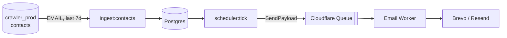

# Email Orchestrator

[](https://github.com/ranjitd-sys/email_orchestrator/actions/workflows/ci.yml)

Two-part email orchestration system implementing the spec in
`docs/Email_Orchestrator_Final_State_Machine_Developer_Spec.md`.

For a diagram-first, module-by-module reference, see **[`ARCHITECTURE.md`](ARCHITECTURE.md)**.
For a plain-English walkthrough, see [`docs/WHAT_WE_BUILT.md`](docs/WHAT_WE_BUILT.md).



## Layout

```
packages/shared     # enums + contract types (used by both apps)
packages/db         # migrations, schema, queries, contact ingest, templates
apps/orchestrator   # Bun process: state machine, scheduler, queue producer
apps/worker         # Cloudflare Worker: stateless email sender, queue consumer
scripts/            # doc, diagram-adjacent, and task-tracker generators
docs/               # spec, build plan, task tracker
```

The split follows spec §11: the orchestrator owns business state and never calls an
email provider; the worker only executes sends and never chooses a sequence. They
talk through Cloudflare Queues only — there is no internal API and no Worker →
orchestrator callback. The orchestrator publishes the full `SendPayload`.

> [!NOTE]
> Provider webhooks (delivery / open / click) and the endpoint that correlates them back
> to a send attempt are **not built yet**; see [`ARCHITECTURE.md`](ARCHITECTURE.md#known-gaps-and-roadmap).

## Setup

```bash
bun install
cp .env.example .env    # then fill in values
bun run check           # typecheck both apps + run tests
```

## Local database

A `docker-compose.yml` runs `postgres:16-alpine` on `localhost:5432` with
database `email_orchestrator`, user/password `email`. Migrations live in
`packages/db/migrations` as default-export Effect programs and are applied by
`effect/sql`'s `Migrator`, which tracks applied versions in `effect_sql_migrations`.

```bash
bun run db:up          # start the container (first run pulls the image)
bun run db:migrate     # apply pending migrations (idempotent)
bun run db:psql        # shell into psql
bun run db:reset       # wipe the volume and start fresh
bun run db:down        # stop the container
```

## Data ingestion

Contacts are pulled from a **separate** Postgres database (`crawler_prod`) via
`EMAIL_DATABASE_URL`. `bun run ingest:contacts`:

- reads contacts where `upper(type) = 'EMAIL'`, created within the **last 7 days**, with a
  light `~ '@'` sanity check;
- upserts them into `leads` on `(dataset_id, lower(email))` (idempotent — re-running never
  duplicates a lead);
- skips suppressed addresses (`leads.suppressed_at` / `suppression_list`);
- schedules the first `NOT_OPENED` step for each newly inserted lead, attaching the
  configured sender (`domains` / `mailboxes`).

```bash
bun run ingest:contacts        # crawler_prod -> leads + NO_1 actions
bun run scheduler:tick         # due actions -> queue -> worker -> provider
```

Run both together as the daily loop:

```bash
bun run ingest:contacts && bun run scheduler:tick
```

See [`ARCHITECTURE.md`](ARCHITECTURE.md#ingestion-crawler-contacts-to-leads) for the full
sequence.

## Commands

| Command | Purpose |
|---|---|
| `bun run check` | Typecheck both apps and run tests |
| `bun run typecheck` | Typecheck orchestrator + packages only |
| `bun run test` | Run tests |
| `bun run test:runtime` | Run the Bun-runtime tests only (what CI runs) |
| `bun run lint` | Lint the Bun-runtime sources with Biome |
| `bun run ingest:contacts` | Sync `crawler_prod` contacts into leads + schedule NO_1 |
| `bun run scheduler:tick` | One scheduler pass: due actions → queue → worker |
| `bun run dev:orchestrator` | Start the orchestrator on :3000 |
| `bun run db:up` / `db:migrate` / `db:seed` / `db:psql` / `db:reset` | Local database lifecycle |
| `bun run worker:deploy` / `worker:plan` / `worker:dev` | Cloudflare Worker via Alchemy |

## Continuous integration

`.github/workflows/ci.yml` runs on every push to `main`, every pull request to
`main`, on a weekly schedule, and on demand. It has a single job —
`Test (includes SAST CodeQL and SCA Dependabot)` — that checks out the repo,
calls the local composite action `.github/actions/setup` (which installs the Bun
version pinned in `.bun-version` and runs a frozen-lockfile install against a
`bun.lock`-keyed download cache), then runs typecheck, tests, and Biome lint.

CI deliberately covers the Bun runtime only. The Worker is a Cloudflare
deployment target with no local build step, so it is deployed with Alchemy
(`bun run worker:deploy`) rather than compiled here. Nothing in CI requires
PostgreSQL, network access, or secrets; all tests are hermetic.

`.github/dependabot.yml` tracks `bun`, `github-actions`, and `docker`
(the root `docker-compose.yml`) weekly.

### Security summary

The same job runs CodeQL (advanced setup, `security-and-quality` queries) and
then writes **SAST (CodeQL)** and
**SCA (Dependabot)** cards into the run's job summary, each linking to the
Security tab. The cards render as Markdown — GitHub does not allow workflow
files to reproduce native card styling, so they are an information-equivalent
approximation. No dependency scanner runs inside CI; the SCA card reads
Dependabot alerts directly, keeping the Bun-runtime scope free of Worker-only
dependency noise.

The CodeQL card reads the code scanning API with the built-in `GITHUB_TOKEN`
(`security-events: write`); code scanning on a public repository is free and
requires no GitHub Advanced Security. The Dependabot card reads the Dependabot
alerts API, which the built-in token cannot access; add a repository secret named
`DEPENDABOT_ALERTS_TOKEN` (a classic PAT with the `security_events` scope, or a
fine-grained PAT with **Dependabot alerts: read**) to populate it. Without the
secret the card renders a short explanatory note instead of failing the job.

Because this workflow uses **advanced setup**, do not also enable CodeQL
**Default Setup** for this repository — GitHub rejects a repository that has both
for the same language.

### Worker (Cloudflare, via Alchemy)

The Worker's Cloudflare resources are declared in `apps/worker/alchemy.run.ts` —
there is no `wrangler.jsonc`. Alchemy provisions the Worker, the send queue, the
dead-letter queue, and the queue consumer.

```bash
cd apps/worker
bunx alchemy profile edit --add Cloudflare   # one-time auth
bun run plan      # preview
bun run deploy    # apply
bun run dev       # local emulation of queue + consumer
bun run destroy   # tear down
```

`bun run deploy` prints the account id and queue id; copy them into
`.env` for the orchestrator.

## Deployment (VPS + Docker + Caddy)

The orchestrator ships as a Bun container (`Dockerfile`) fronted by Caddy for
automatic HTTPS. Production topology is in `docker-compose.prod.yml`
(`orchestrator` + `caddy`); it uses your existing Postgres via `DATABASE_URL`
and does **not** start a database container. Caddy terminates TLS for
`event.deepecom.shop` and reverse-proxies to the orchestrator on port 3000.

### Brevo webhook endpoint

The server exposes `POST /webhooks/brevo/<BREVO_WEBHOOK_SECRET>` for Brevo
**outbound (transactional)** events (delivered / opened / click / bounce /
spam / unsubscribed). The path secret must equal `BREVO_WEBHOOK_SECRET` in the
container env. Configure the Brevo webhook URL as:

```
https://event.deepecom.shop/webhooks/brevo/<your BREVO_WEBHOOK_SECRET>
```

The endpoint validates the secret, accepts a single object or a batched array,
logs each event with its correlation `tags`, and returns `200` fast. (Persisting
to `email_events` and driving the engagement state machine is the next phase.)

### How deploys work (GHCR)

The image is **built in CI and pushed to GHCR**
(`ghcr.io/ranjitd-sys/email_orchestrator`); the VPS only **pulls** it — it needs
Docker and nothing else (no git, no source, no build). `docker-compose.prod.yml`
references the image by `IMAGE_TAG` (the git sha) so each deploy is traceable and
rollback is a redeploy of an older tag.

### CI/CD

`.github/workflows/deploy.yml`:

1. `ci-gate` — typecheck + tests + lint.
2. `build-and-push` — build the Dockerfile and push `:<sha>` + `:latest` to GHCR.
3. `deploy` — SSH to the VPS, ship `docker-compose.prod.yml` + `Caddyfile` +
   `scripts/deploy-prod.sh`, write `/srv/email/.env` from secrets, `docker login`
   GHCR, `docker compose pull`, run migrations, `up -d`, then curl `/health`.

Required `production` environment secrets: `DEPLOY_SSH_HOST` (bare VPS IPv4),
`DEPLOY_SSH_USER`, `DEPLOY_SSH_KEY` (passphrase-less private PEM),
`DATABASE_URL`, `BREVO_WEBHOOK_SECRET`, `GHCR_USER`, and `GHCR_PULL_TOKEN`
(a PAT with `read:packages`; omit only if the GHCR package is made public).

### First deploy

Just merge to `main` (the workflow provisions `.env` + infra files and pulls the
image). Before that, the VPS needs Docker installed and the DNS A record
`event.deepecom.shop` → VPS IP (Caddy auto-issues TLS on port 80/443). To verify:

```bash
curl https://event.deepecom.shop/health
```

## Environment

See `.env.example`. The key ones:

- `DATABASE_URL` — hosted Postgres (source of truth)
- `EMAIL_DATABASE_URL` — crawler contacts Postgres used by `ingest:contacts`
- `CLOUDFLARE_ACCOUNT_ID`, `CLOUDFLARE_QUEUE_ID`, `CLOUDFLARE_API_TOKEN` — the
  orchestrator pushes send jobs to the queue over HTTP; the token needs the
  `Queues Edit` permission
- `EMAIL_PROVIDER`, `RESEND_API_KEY`, `BREVO_API_KEY` — set on the Worker through
  Alchemy env, not read by the orchestrator

> [!IMPORTANT]
> Without the Cloudflare queue trio the orchestrator falls back to an in-memory
> `LocalQueue`, which does not survive the one-shot scheduler process exiting.

## State machines

There are **two** machines, both in `apps/orchestrator/src/domain/`:

- `orchestrator-machine.ts` — the scheduler flow `PULLED → DECIDED → SENT` (with
  `cancelled` / `failed` finals). `pipeline.ts` drives it while executing actor Effects
  inside a single `withTransaction`, so the flow and the database share one fiber.
- `transition.ts` — the pure lead-engagement machine covering `NEW`, `NOT_OPENED`,
  `OPENED`, `CLICKED`, `REPLIED`, `SUPPRESSED`. It returns the next position plus an
  ordered action list (`CREATE_SEQUENCE`, `CREATE_STEP`, `CANCEL_REMAINING`,
  `CANCEL_ALL_FUTURE`, `COMPLETE_SEQUENCE`, `SUPPRESS`, `RECORD_ONLY`) and never touches
  the database.

Actors (`actors.ts`) convert a pulled action into a `SendPayload` and persist the next
step, resolved most-specific-first: step actor → state actor → `defaultActor`. Event
precedence (suppression → replied → clicked → opened) lives in `precedence.ts`.

See [`ARCHITECTURE.md`](ARCHITECTURE.md#scheduler-flow-pulled-to-sent).

## Progress

Task tracking lives in `docs/Email_Orchestrator_Tasks.csv` (source of truth).
`docs/Email_Orchestrator_Schedule.csv` breaks it into 2-day sprints.
Run `bun run tasks` after editing the CSV to refresh `docs/BUILD_TASKS.md`.